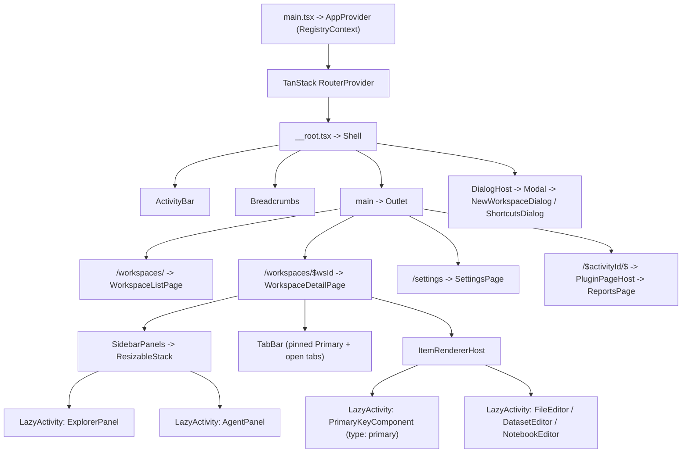
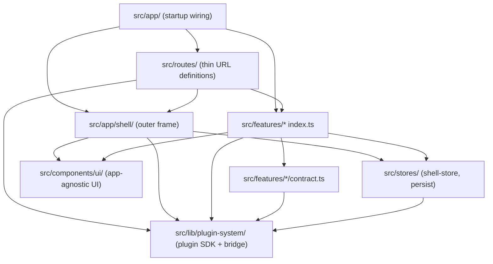
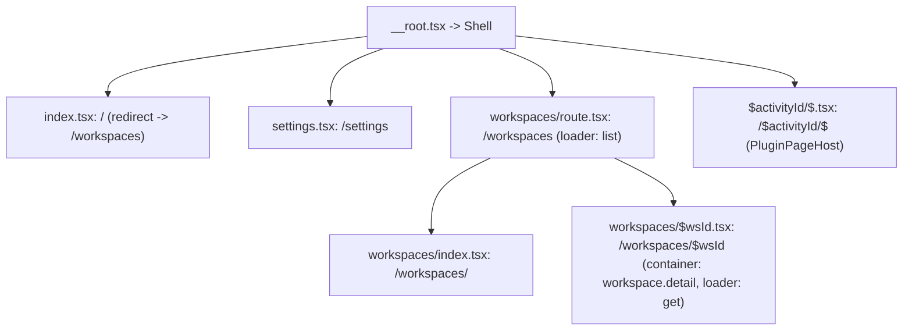
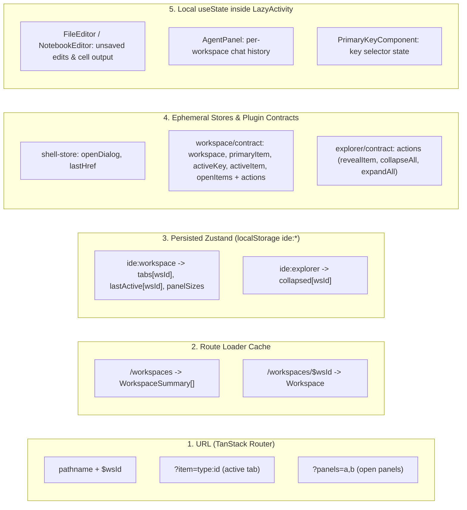

# IDE Shell — Design Document

This document explains how **IDE Shell** works: screen layout, folder boundaries, URL rules, state ownership, cross-plugin contracts, critical user journeys, and how to extend the shell.

---

## 1. Overview

IDE Shell is a VS Code–style web app shell built with **React 19.3**, **TanStack Router**, **Zustand 5**, **Vite 8**, and **TypeScript 6**.

- **What it provides:**
  - A fixed outer frame: left Activity Bar, top Breadcrumb bar, main page area, and a shared modal host.
  - A boot-time plugin registry so features (`workspace`, `primary`, `explorer`, `agent`, `notebook`, `reports`, `settings`) contribute buttons, dialogs, sidebar panels, pages, and uniform `itemRenderers` (including the pinned `type: 'primary'` tab) without importing each other's internals.
  - A typed plugin contract pattern (`createPluginBridge` + `.usePublish(...)` in `lib/plugin-system`, exposed via `src/features/<name>/contract.ts`), alongside route-agnostic shell state (`useShellLocation`).
- **What it intentionally leaves out (for now):**
  - Real backend persistence (`workspaces.ts` and `agent.ts` use in-memory mock data).
  - Runtime plugin installation/unloading (plugins register once at startup in `src/app/plugins.ts`).
  - Heavy code editors or multi-pane splits.

---

## 2. Screen & Component Layout

### 2.1 Workspace Detail Layout

```text
+------+-----------------------------------------------------------------------+
| Act  | Breadcrumbs: Workspaces > [Acme v] > Storefront Core > checkout.ts    |
| Bar  +-------------------------+---------------------------------------------+
|      | EXPLORER                | [Storefront Core] [checkout.ts x] [utils x] |
| [WS] | v [Key] Storefront Core +---------------------------------------------+
| [Ag] |     catalog.csv         |                                             |
| [Rp] |     checkout.ts         |   ItemRendererHost                          |
|      | v Files (3)             |   - Pinned Primary tab (index 0, primary)   |
|      |     App.tsx             |   - Open file / dataset / notebook tabs     |
|      |     README.md           |   (mounted on first view, kept in Activity) |
|      |     utils.ts            |                                             |
|      | v Datasets (1)          |                                             |
|      |     sales.csv           |                                             |
|      +======== divider ========+  (drag with pointer or resize with arrows)  |
|      | AGENT               [x] |                                             |
| [+]  | Context: Acme > ...     |                                             |
| [?]  | Primary: Storefront ... |                                             |
| [*]  | [Ask about checkout.ts] |                                             |
+------+-------------------------+---------------------------------------------+
```

### 2.2 Component Tree



---

## 3. Folder Layers & Dependency Rules

`eslint.config.js` dynamically scans `src/features/` and enforces strict one-way imports with `no-restricted-imports` (blocking both `@/` aliases and relative `../` escapes).



| Folder | Owns | May import | Blocked by ESLint |
| --- | --- | --- | --- |
| `src/app/` & `src/routes/` | Startup & thin route files | `@/features/<name>` (`index.ts`), `app/shell`, `lib`, `stores` | Deep `@/features/<name>/**` |
| `src/app/shell/` | `Shell`, `ActivityBar`, `Breadcrumbs`, `DialogHost`, `PluginPageHost` | `lib`, `stores`, `components` | `features`, `routes` |
| `src/features/<name>/**` | Self-contained plugins (`workspace`, `primary`, `explorer`, `agent`, `notebook`, `reports`, `settings`) | `lib`, `stores`, `components`, `@/features/<other>/contract`, own relative files | `app`, `routes`, sibling feature barrels & internals (both `@/` and `../`) |
| `src/features/*/contract.ts` | Shareable plugin state & actions (`createPluginBridge`) | `@/lib/plugin-system` | `app`, `routes`, `features`, `stores`, `components`, relative files |
| `src/stores/` | Shell-wide state (`shell-store.ts`, `persist.ts`) | `lib` | `app`, `routes`, `features`, `components` |
| `src/lib/` | Plugin SDK (`types.ts`, `bridge.ts`, `registry.ts`, `search-params.ts`, `shell-location.ts`, `router-types.ts`) | External packages only | All app folders above it |
| `src/components/ui/` | App-agnostic UI (`Modal`, `ResizableStack`, `LazyActivity`, `Breadcrumb`, `ActivityBarButton`) | External packages only | All app folders above it |

---

## 4. URL Design & Route Map



```text
  /workspaces / acme  ?  item=file:utils  &  panels=agent
  \_________/   \__/     \_____________/     \__________/
   area home    $wsId      active tab       open optional panels
                        (omitted = Primary) (comma-separated IDs)
```

- **Omitted `?item=` means the pinned Primary tab (`PRIMARY_TYPE = 'primary'`) is active.**
- **Search validation (`validateDetailSearch`):** Strips malformed keys (`"abc"`, `":id"`, `"file:"`).
- **Route-agnostic container metadata (`staticData.container`):** `/workspaces/$wsId` declares `container: 'workspace.detail'` and `retainSearchParams(['panels'])`. `ActivityBar` toggles `?panels=` generically via `navigate({ to: '.' })`.
- **History policy:** Switching areas, switching workspaces, creating a workspace, and opening a **new** tab push history; switching to an open tab, switching to Primary, closing a tab, and toggling panels use `replace: true`.
- **Hosting modes (`src/app/router.ts`):** Browser history in dev (`npm run dev`); hash history (`#/`) in `npm run build:demo` for static hosts.

---

## 5. State Ownership & Plugin Contracts



| Store / Source | File | Persisted? | Read Pattern | Purpose |
| --- | --- | --- | --- | --- |
| URL & search params | `routes/workspaces/$wsId.tsx` | In URL | `route.useSearch()`, `useShellLocation()` | Deep links, Back/Forward, refresh-safe active tab/panels |
| Route loaders | `routes/workspaces/route.tsx`, `$wsId.tsx` | Router cache | `route.useLoaderData()` | Server records; `router.invalidate()` refreshes readers |
| `useWorkbench` | `features/workspace/stores/workbench.ts` | Yes (`ide:workspace`) | Selector with `EMPTY` fallback, or `.getState()` | Open tab strips & sidebar split ratios per workspace |
| `useExplorerStore` | `features/explorer/stores/explorer-store.ts` | Yes (`ide:explorer`) | Selector with `EMPTY` fallback | Collapsed folders/groups per workspace |
| `useShell` | `stores/shell-store.ts` | No (cleared on Reset) | Selector (`openDialog`) or `.getState()` (`lastHref`) | Active modal dialog & per-activity last URL |
| `useWorkspaceContract` | `features/workspace/contract.ts` | No | Narrow primitive selectors in render; `.getState()` in handlers | Shares workspace, `primaryItem`, tabs, and tab/primary actions |
| `useExplorerContract` | `features/explorer/contract.ts` | No | `.getState().actions` in handlers | Lets breadcrumbs & agent reveal items or collapse/expand Explorer |
| Local `useState` | `FileEditor`, `NotebookEditor`, `AgentPanel`, `PrimaryKeyComponent` | No (`LazyActivity` while mounted) | React state | Defers lazy chunks until first open, then preserves state across switches |

### 5.1 Public State & Plugin Contract Guide

| Public API | Import Path | Available When | What It Provides |
| --- | --- | --- | --- |
| **`useShellLocation()`** | `@/lib/plugin-system` | Always | `{ path, container, panels }` |
| **`useRegistry()`** | `@/lib/plugin-system` | Always | `plugins`, `activity`, `panel`, `itemRenderer`, `panelsFor(container)`, `activeRouteActivity(path)` |
| **`useWorkspaceContract`** | `@/features/workspace/contract` | On `/workspaces/$wsId` (`null` elsewhere) | `current`: `{ workspace, primaryItem, activeKey, activeItem, openItems }`<br>`actions`: `{ isActiveWorkspace(wsId), showPrimary(), setPrimaryItem(input), openItem(itemId), closeItem(itemId) }` |
| **`useExplorerContract`** | `@/features/explorer/contract` | While `ExplorerPanel` is mounted (`null` elsewhere) | `actions`: `{ revealItem(itemId), collapseAll(), expandAll() }` |
| **`resetAllPersisted()`** | `@/stores/persist` | Always | Resets all registered `ide:*` stores and `lastHref` in memory |

#### 1. Reading Shell State (`@/lib/plugin-system`)

```tsx
// In plugin.ts — declarative enable/disable based on the active route's staticData.container:
enabledWhen: (loc) => loc.container === 'workspace.detail',

// Inside any plugin component:
const { path, container, panels } = useShellLocation();
const fileRenderer = useRegistry().itemRenderer.get('file');
```

#### 2. Consuming Another Plugin's Contract (`@/features/<name>/contract`)

1. **In React render, select narrow primitives** so unrelated tab/panel updates do not re-render your component:
   ```tsx
   import { useWorkspaceContract } from '@/features/workspace/contract';

   const wsName = useWorkspaceContract((s) => s.current?.workspace.name);
   const primaryName = useWorkspaceContract((s) => s.current?.primaryItem?.name);
   const activeName = useWorkspaceContract((s) => s.current?.activeItem?.name);
   ```
2. **In event handlers and `async` code, use `.getState()`** (zero render subscriptions, safe across `await`):
   ```tsx
   // Event handler:
   useExplorerContract.getState().actions?.revealItem('primary-acme');

   // Async handler — snapshot before await, re-verify workspace after await:
   const asked = useWorkspaceContract.getState().current;
   const reply = await myAsyncTask(asked);
   if (asked && useWorkspaceContract.getState().actions?.isActiveWorkspace(asked.workspace.id)) {
     useWorkspaceContract.getState().actions?.openItem('primary-acme-checkout');
   }
   ```
3. **Always treat `current` and `actions` as nullable (`?.`)** so features degrade cleanly when outside a workspace or when an optional plugin is omitted.

#### 3. Publishing Shareable State from Your Own Plugin (`.usePublish`)

Only add stores your plugin needs: **0 stores** (`primary`, `notebook`, `reports`, `settings`), **actions-only bridge** (`explorer`), or **persisted store + snapshot/actions bridge** (`workspace`).

```ts
// 1. src/features/my-plugin/contract.ts (imports ONLY from @/lib/plugin-system)
import { createPluginBridge } from '@/lib/plugin-system';

export interface MySnapshot {
  readonly activeFilter: string;
}
export interface MyActions {
  setFilter(filter: string): void;
}

export const useMyPluginContract = createPluginBridge<MySnapshot, MyActions>();
export const usePublishMyPluginContract = useMyPluginContract.usePublish;
```

```tsx
// 2. Inside your mounted plugin component/hook (pass `null` as snapshot for actions-only bridges):
import { usePublishMyPluginContract } from '../contract';

usePublishMyPluginContract({ activeFilter }, { setFilter });
```

Compute any derived arrays in the component/hook body (where React Compiler memoizes them by input identity) rather than inside effects, keeping `===` reference stability for subscribers.

---

## 6. Critical User Journeys (CUJs)

| Journey | User Flow | Key State & Edge Cases Handled |
| --- | --- | --- |
| **1. Create Workspace & Select Primary Key** | Click `New workspace` -> enter Name/Description in `NewWorkspaceDialog` -> click `Create` -> lands on `/workspaces/$wsId` -> pick key in `PrimaryKeyComponent` -> click `Select primary key` | Whitespace-only names show `role="alert"` error; new workspace starts with `items: []` (`primaryItem === undefined`); `setPrimaryItem` errors are caught inline without tripping the route error boundary; once selected, `PrimaryKeyComponent` switches in-place to `PrimaryKeyDetail` and Explorer shows `primary-acme*`-style children. |
| **2. Explore Items & Manage Tabs** | Expand folders/groups in `ExplorerPanel`, open `checkout.ts` (`?item=file:primary-acme-checkout`) and `utils.ts` (`?item=file:utils`), edit text, switch/close tabs | `LazyActivity` defers downloading editor chunks until a tab is first viewed, then preserves unsaved edits/cell runs while hidden; `TabBar` keeps roving `tabIndex` reachable even on invalid deep-linked `?item=`; closing the last tab returns to the pinned Primary tab (`?item=` omitted). |
| **3. Switch Workspaces & Top-Level Areas** | Switch `Acme` <-> `Globex` in `WorkspaceBreadcrumbs`, or visit `/reports/q1` and click `Workspaces` again | `ItemRendererHost` keys `LazyActivity` by `${wsId}:${key}` (no cross-workspace state leaks); `?panels=` is retained across workspaces; `Shell` records `lastHref` on `onResolved` so clicking an unselected area restores its exact URL. |
| **4. Resize Sidebar & Chat with Agent** | Toggle `Agent` (`?panels=agent`), drag `.divider` (or press `ArrowUp`/`ArrowDown`), send `"primary key"`, `"open utils.ts"`, or `"collapse all"` | Divider enforces `15%–85%` bounds matching `aria-valuemin`/`aria-valuemax`; `AgentPanel` focuses its input once lazy-loaded, reads `primaryItem` via `workspace/contract`, verifies `isActiveWorkspace(wsId)` after `await`, and routes item actions via `openItem(id) \|\| revealItem(id)`. |
| **5. Reset Layout & Modal Dialogs** | Click `Close all tabs and reset panel sizes` on `/settings`, or open `[+]` / `[?]` dialogs | `resetAllPersisted()` resets `useWorkbench`, `useExplorerStore`, and `lastHref` in memory + removes `ide:*` keys without `location.reload()`; `Modal` uses `<dialog closedby="any">` with a pointerdown-bounds fallback for Safari. |

---

## 7. Extending the Shell

Export a plugin with `definePlugin(...)` from `src/features/<name>/plugin.ts` (via `index.ts`) and add it to `src/app/plugins.ts`.

| Goal | What to change |
| --- | --- |
| Share state/actions with other plugins | Export `createPluginBridge<Snapshot, Actions>()` from `src/features/<name>/contract.ts` and publish via `useMyContract.usePublish(...)`. |
| Add a new Explorer item renderer | Add `{ type, label, pluralLabel?, icon, component: lazy(...) }` to `itemRenderers` in `src/features/<name>/plugin.ts` (see `src/features/notebook/`). |
| Customize or swap the pinned Primary renderer | Update or replace `src/features/primary/plugin.ts` (`type: PRIMARY_TYPE`). Receives `{ workspace, item }` (`item === undefined` until selected) and calls `useWorkspaceContract.getState().actions?.setPrimaryItem(...)`. |
| Add a sidebar panel + toggle button | Add a `panels` entry (`container: 'workspace.detail'`) and an `activities` entry with `action: { kind: 'togglePanel', panelId }`. |
| Add a standalone plugin page | Add an `activities` entry with `action: { kind: 'route', to: '/<id>', page: lazy(...) }`. No file in `src/routes/` needed. |
| Add a modal dialog button | Add an `activities` entry with `action: { kind: 'dialog', dialog: lazy(...) }` (see `NewWorkspaceDialog` and `ShortcutsDialog`). |
| Connect a real backend | Replace the mock functions in `src/features/workspace/api/workspaces.ts` and `src/features/agent/api/agent.ts` with `fetch` calls, keeping `router.invalidate()` after mutations. |

### 7.1 Uniform `ItemRenderer` Contract

`createRegistry(plugins)` merges `itemRenderers` across all plugins using one uniform contract:

```ts
export interface ItemRendererProps {
  readonly workspace: WorkspaceInfo;
  readonly item?: Item;
}

export interface ItemRenderer {
  readonly type: string;
  readonly label: string;
  readonly pluralLabel?: string;
  readonly icon: Icon;
  readonly component?: Lazy<ItemRendererProps>;
}
```

- **Pinned Primary (`src/features/primary/plugin.ts`):** Registers `type: PRIMARY_TYPE` -> `PrimaryKeyComponent`, mounted in tab `0` (`?item=` omitted). Owns both unselected (`item === undefined`) and configured (`item !== undefined`) states internally.
- **Standalone feature renderer (`src/features/notebook/plugin.ts`):** Registers `type: 'notebook'` -> `NotebookEditor`, grouped under **Notebooks** in Explorer and opened in closable tabs.
- **Core viewers & folders (`src/features/workspace/plugin.ts`):** Registers `file` (`FileEditor`), `dataset` (`DatasetEditor`), and `folder` (`component` omitted—top-level folders render with their nested `parentId` subtree, and clicking toggles expand/collapse). Unregistered backend item types appear under **Other** in Explorer.

---

## 8. Verification & CI Pipeline

Checked locally and on push to `main` via `.github/workflows/deploy-pages.yml`:

1. `npm run typecheck` (`tsc --noEmit`) — strict TypeScript 6 + `noUncheckedIndexedAccess`.
2. `npm run lint` (`eslint .`) — TypeScript rules, React Hooks / React Compiler rules, and folder + plugin-contract boundaries.
3. `npm test` (`node --import ./tests/setup-aliases.mts --test 'tests/**/*.test.ts'`) — Node 24 unit tests for `createRegistry`, `createPluginBridge`, `tabs`, `explorer`, `workbench`, `agentApi`, `search-params`, and `workspacesApi`.
4. `npm run build` / `npm run build:demo` — production Vite build (failing on any React Compiler `CompileError`) and single-file `#/` demo bundle for GitHub Pages.
