# IDE Shell — Design Document

This document explains how **IDE Shell** works in plain English: screen layout, folder rules, URLs, state and contracts, data flows, and **Critical User Journeys (CUJs)** with their **Critical User Interactions (CUIs)**.

Every diagram and table maps directly to real files in `src/`.

---

## 1. What This App Does (and What It Leaves Out)

IDE Shell is a VS Code–style web app shell built with **React 19.3**, **TanStack Router**, **Zustand 5**, **Vite 8**, and **TypeScript 6**.

- **What it provides:**
  - A fixed outer frame: left Activity Bar, top Breadcrumb bar, main page area, and a shared modal host.
  - A boot-time plugin registry so features (`workspace`, `primary`, `explorer`, `agent`, `notebook`, `reports`, `settings`) contribute buttons, dialogs, sidebar panels, pages, and uniform `itemRenderers` (including the pinned `type: 'primary'` tab) without importing each other's internals.
  - A typed plugin contract pattern (`createPluginBridge` in `lib/plugin-system` + `src/features/<name>/contract.ts`): in-house `workspace` and `explorer` features demonstrate bidirectional cross-plugin state sharing consumed by `primary`, `agent`, and breadcrumbs, while all features read route-agnostic shell state (`useShellLocation`).
- **What it intentionally leaves out (for now):**
  - Real backend persistence (`workspaces.ts` and `agent.ts` use in-memory mock data that resets on a full browser reload).
  - Runtime plugin installation/unloading (all plugins are registered once at startup in `src/app/plugins.ts`).
  - Heavy code editors like Monaco or multi-pane editor splits.

---

## 2. Screen & Component Layout

### 2.1 Visual Screen Layout (Workspace Detail View)

```text
+------+-----------------------------------------------------------------------+
| Act  | Breadcrumbs: Workspaces > [Acme v] > Storefront Core > checkout.ts    |
| Bar  +-------------------------+---------------------------------------------+
|      | EXPLORER                | [Primary Key] [checkout.ts x] [utils.ts x]  |
| [WS] | v [Key] Storefront Core +---------------------------------------------+
| [Ag] |     catalog.csv         |                                             |
| [Rp] |     checkout.ts         |   ItemRendererHost                          |
|      | v Files (3)             |   - Pinned Primary tab (index 0, primary)   |
|      |     App.tsx             |   - Open file / dataset / notebook tabs     |
|      |     README.md           |   (hidden tabs stay mounted in Activity)    |
|      |     utils.ts            |                                             |
|      | v Datasets (1)          |                                             |
|      |     sales.csv           |                                             |
|      +======== divider ========+  (drag with pointer or resize with arrows)  |
|      | AGENT               [x] |                                             |
| [+]  | Context: Acme > ...     |                                             |
| [?]  | [chat messages]         |                                             |
| [*]  | [Ask about checkout.ts] |                                             |
+------+-------------------------+---------------------------------------------+
```

- **Activity Bar** (`48px`, left): Top group holds area/panel buttons (`Workspaces`, `Agent`, `Reports`). Bottom group holds utility buttons (`New workspace` dialog, `Keyboard shortcuts` dialog, `Settings`).
- **Breadcrumbs** (`30px`, top): Built from the active nested routes. Inside a workspace, shows a workspace `<select>` switcher plus clickable parent nodes (or the primary item / `Primary Key` label when the pinned Primary tab is active).
- **Sidebar** (`260px` desktop / `44vw` phone): Stacked panels managed by `ResizableStack`. `Explorer` is always visible; optional panels like `Agent` appear when listed in `?panels=`.
- **TabBar + ItemRendererHost** (right): The **Primary** tab (`type: 'primary'`) is always pinned at index `0` with no close button and renders the registered `primary` `ItemRenderer` (`PrimaryKeyComponent`). Other items with a `component` (`file`, `dataset`, `notebook`) open as closable tabs to its right.

### 2.2 React Component Tree

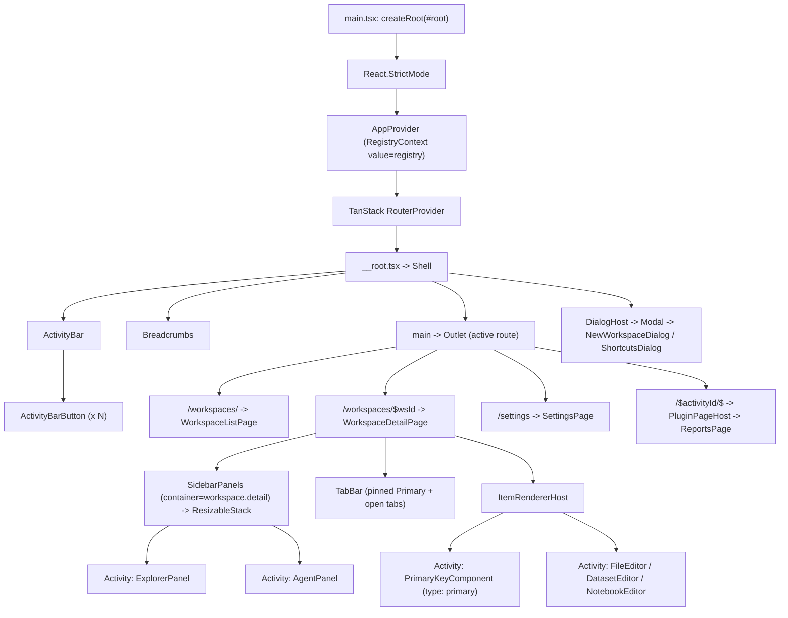

---

## 3. Folder Layers & Dependency Rules

To keep features independent while letting any plugin expose shareable state, `eslint.config.js` enforces strict one-way imports and co-located `contract.ts` boundaries with `no-restricted-imports` (blocking both `@/` aliases and relative `../` escapes).

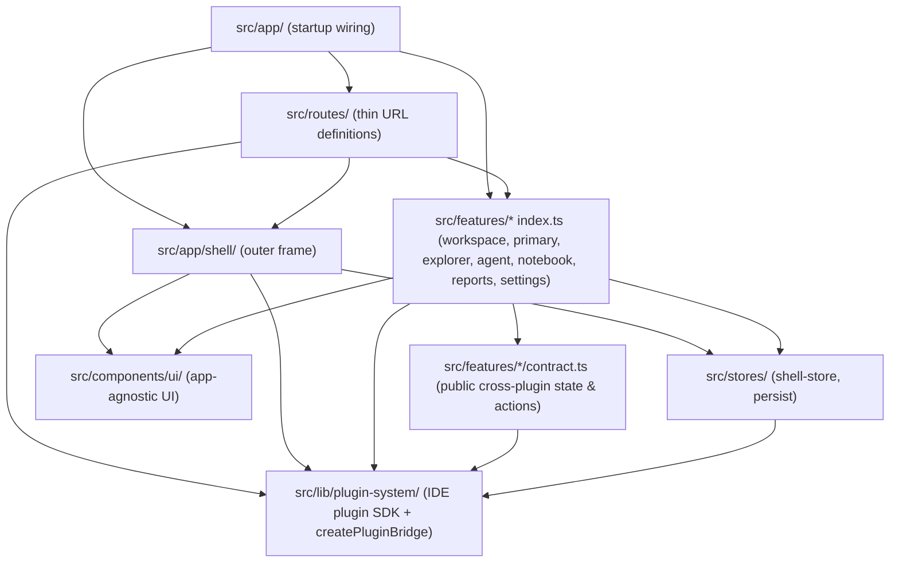

| Folder | Owns | May import | Blocked by ESLint |
| --- | --- | --- | --- |
| `src/app/` & `src/routes/` | Startup & thin route files | `@/features/<name>` (`index.ts`), `app/shell`, `lib`, `stores` | Deep `@/features/<name>/**` |
| `src/app/shell/` | `Shell`, `ActivityBar`, `Breadcrumbs`, `DialogHost`, `PluginPageHost` | `lib`, `stores`, `components` | `features`, `routes` |
| `src/features/<name>/**` | Self-contained plugins (`workspace`, `primary`, `explorer`, `agent`, `notebook`, `reports`, `settings`) | `lib`, `stores`, `components`, `@/features/<other>/contract`, own relative files | `app`, `routes`, sibling feature barrels & internals (both `@/` and `../`) |
| `src/features/*/contract.ts` | Shareable plugin state & actions (`createPluginBridge`) | `@/lib/plugin-system` | `app`, `routes`, `features`, `stores`, `components`, relative files |
| `src/stores/` | Shell-wide state (`shell-store.ts`, `persist.ts`) | `lib` | `app`, `routes`, `features`, `components` |
| `src/lib/` | Plugin SDK (`types.ts`, `bridge.ts`, `registry.ts`, `search-params.ts`, `shell-location.ts`, `router-types.ts`) | External packages only | All app folders above it |
| `src/components/ui/` | App-agnostic UI (`Modal`, `ResizableStack`, `Breadcrumb`, `ActivityBarButton`) | External packages only | All app folders above it |

---

## 4. URL Design & Route Map

### 4.1 File-Based Route Tree

TanStack Router's Vite plugin watches `src/routes/` and generates `src/routeTree.gen.ts`. Static routes always match ahead of dynamic params (`$activityId`), so `/workspaces` and `/settings` match before `/$activityId/$`.

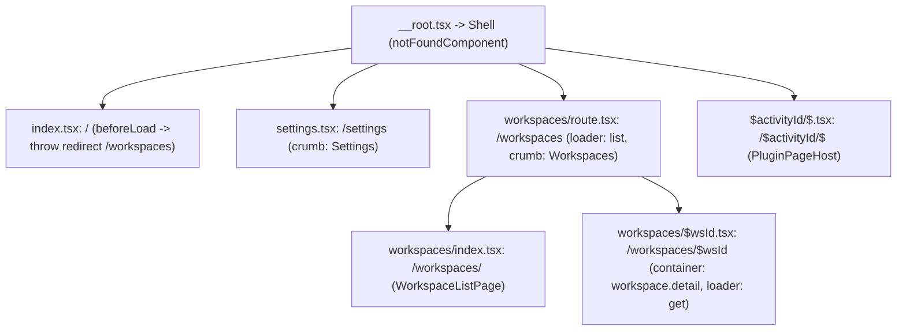

### 4.2 URL Anatomy & Rules

Example URL inside a workspace:

```text
  /workspaces / acme  ?  item=file:utils  &  panels=agent
  \_________/   \__/     \_____________/     \__________/
   area home    $wsId      active tab       open optional panels
                        (omitted = Primary) (comma-separated IDs)
```

- **Omitted `?item=` means the pinned Primary tab (`type: 'primary'`) is active.** There is no `?item=primary` noise in the URL.
- **Validation (`validateDetailSearch` in `src/features/workspace/lib/search.ts`):** Rejects malformed keys (missing `:`, empty type, or empty id such as `"abc"`, `":id"`, `"file:"`).
- **Route-agnostic container metadata (`staticData.container`):** `/workspaces/$wsId` declares `staticData: { container: 'workspace.detail' }`. `useShellLocation()` reads `container`, `pathname`, and `?panels=` in a single structurally-shared subscription, and `ActivityBar` toggles `?panels=` generically via `navigate({ to: '.' })`.
- **Panel retention:** `/workspaces/$wsId` applies `retainSearchParams(['panels'])`, so switching workspaces or opening tabs keeps `?panels=agent` open automatically.
- **Browser history policy (`push` vs `replace`):**
  - **Push** (adds a Back step): Switching areas, switching workspaces, creating a workspace (`NewWorkspaceDialog` -> `/workspaces/$wsId`), and opening a **new** item tab for the first time.
  - **Replace** (does not clutter Back): Switching to an already-open tab, switching to the pinned Primary tab, closing a tab, and toggling a sidebar panel (`?panels=`).
- **Longest-prefix activity match:** `registry.activeRouteActivity(path)` sorts route activities by `action.to.length` descending so `ActivityBar` highlights the most specific matching route activity and `Shell` records `lastHref` only for activities with `rememberLastLocation: true`.
- **Hosting modes (`src/app/router.ts`):**
  - Local dev (`npm run dev`): Browser history (`/workspaces/acme`) — Vite serves `index.html` on refresh.
  - Static demo / GitHub Pages (`npm run build:demo`): Hash history (`#/workspaces/acme`) — refreshes and deep links work on static hosts without 404s.

### 4.3 Breadcrumb Assembly

Routes declare breadcrumbs in `staticData` (typed via module augmentation in `src/lib/plugin-system/router-types.ts`):

- `crumb?: (params, registry) => string` for plain text labels (`Workspaces`, `Settings`, `Reports`).
- `Breadcrumbs?: ComponentType` for interactive segments (`WorkspaceBreadcrumbs`, rendering the workspace `<select>` switcher + clickable parent containers or the primary item / `Primary Key` label).

`app/shell/Breadcrumbs.tsx` subscribes to a structurally-shared route slice (so `?item=` and `?panels=` changes do not re-render the shell bar), waits for `status === 'success'` before rendering a custom component, and wraps it in `<Suspense>`.

---

## 5. State & Contract Architecture

Every piece of state has **one clear owner**—server records stay in TanStack Router loaders, layout state lives in Zustand, cross-plugin state flows through `contract.ts` bridges, and active location lives in the URL.

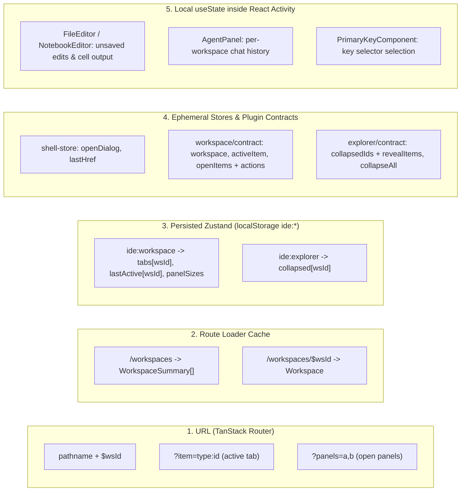

### 5.1 State Ownership Summary

| Store / Source | File | Persisted? | Read Pattern | Why it lives here |
| --- | --- | --- | --- | --- |
| URL & search params | `routes/workspaces/$wsId.tsx` | In browser URL | `route.useSearch()`, `useShellLocation()` | Shareable links, browser Back/Forward, refresh safe |
| Route loaders | `routes/workspaces/route.tsx`, `$wsId.tsx` | In-memory router cache | `route.useLoaderData()` | Server data; `router.invalidate()` refreshes all readers at once |
| `useWorkbench` | `features/workspace/stores/workbench.ts` | Yes (`ide:workspace`, `version: 3`) | Selector with frozen `EMPTY` fallback, or `.getState()` in handlers | Open tab strips & panel ratios survive refresh |
| `useExplorerStore` | `features/explorer/stores/explorer-store.ts` | Yes (`ide:explorer`, `version: 1`) | Selector with frozen `EMPTY` fallback | Explorer collapsed folders/groups survive refresh |
| `useShell` | `stores/shell-store.ts` | No (cleared on Reset) | Selector (`openDialog`) or `.getState()` (`lastHref`) | Back button should not reopen modals; session-only memory |
| `useWorkspaceContract` | `features/workspace/contract.ts` | No | Narrow primitive selectors in render; `.getState()` in handlers | Lets `primary`, `explorer`, `agent`, and future plugins read/act on workspaces |
| `useExplorerContract` | `features/explorer/contract.ts` | No | Selector or `.getState()` in handlers | Reference example: lets `workspace` breadcrumbs & `agent` reveal/collapse Explorer nodes |
| Local `useState` | `FileEditor`, `NotebookEditor`, `AgentPanel`, `PrimaryKeyComponent` | No (kept alive by `Activity` while route stays mounted) | Normal React state | Survives tab/panel switches inside a workspace without a global drafts store |

### 5.2 Important Persistence & Performance Boundaries

- **What survives switching tabs inside the same workspace:** Unsaved `FileEditor` text, `NotebookEditor` cell output, `PrimaryKeyComponent` state, and `AgentPanel` chat all survive because `ItemRendererHost` and `ResizableStack` keep hidden children mounted inside React `<Activity>`.
- **Synchronous contract sync (`useLayoutEffect`) & no-op persistence guards:** `useSyncWorkspaceContract` and `ExplorerPanel` publish snapshots via `useLayoutEffect` (zero 1-frame lag), and `useWorkbench` / `useExplorerStore` check `get()` before calling `set()` so Zustand `persist` never writes unchanged state to `localStorage`.
- **Zero shell/panel re-render cascades on tab switch:** `useShellLocation` omits `?item=`, `Shell` records `lastHref` via `router.subscribe('onResolved')`, `ActivityBar` reads `lastHref` via `.getState()` on click, `ExplorerPanel` caches `buildExplorerTree` strictly on `(items, itemRenderers)`, and `AgentPanel` selects primitive fields (`wsId`, `wsName`, `activeName`).
- **Zero React renders during 120 Hz sidebar resize:** `ResizableStack` updates `flexGrow` and `aria-valuenow` directly via DOM refs on `pointermove` and commits once on `pointerup`.
- **In-memory reset (`src/stores/persist.ts`):** `workbench.ts`, `explorer-store.ts`, and `shell-store.ts` register reset callbacks via `registerResetter(...)`. Clicking reset in Settings runs `resetAllPersisted()`, clearing tabs, panel sizes, collapsed folders, `lastHref`, and `ide:*` keys in `localStorage` without `location.reload()`.

### 5.3 Workspace & Tab State Machine

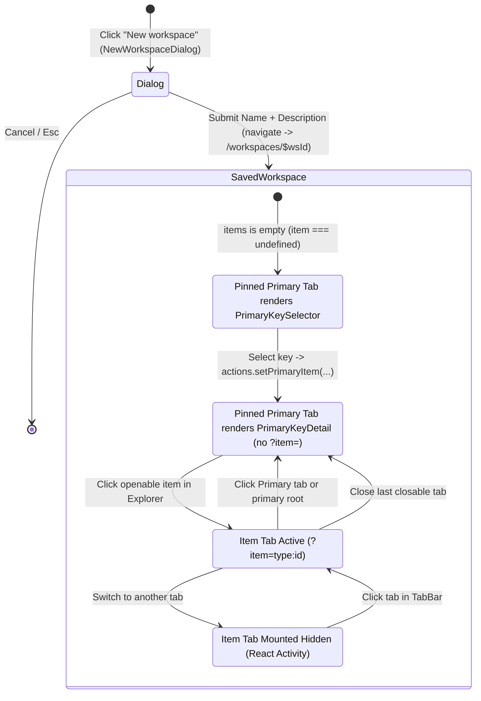

### 5.4 Public State & Plugin Contract Guide (How to Read & Share State)

Plugins never import another plugin's internal files (`stores/`, `components/`, `hooks/`). Instead, every plugin accesses shared state through **two public layers** enforced by ESLint:

| Public API | Import Path | Available When | What It Provides |
| --- | --- | --- | --- |
| **`useShellLocation()`** | `@/lib/plugin-system` | Always | `{ path, container, panels }` — current URL path, active container ID (e.g. `'workspace.detail'`), and open optional `?panels=` |
| **`useRegistry()`** | `@/lib/plugin-system` | Always | Boot-time plugin contributions: `plugins`, `activity`, `panel`, `itemRenderer`, `panelsFor(container)`, `activeRouteActivity(path)` |
| **`useWorkspaceContract`** | `@/features/workspace/contract` | On `/workspaces/$wsId` (`null` elsewhere) | `current`: `{ workspace, primaryItem, activeKey, activeItem, openItems }`<br>`actions`: `{ isActiveWorkspace(wsId), showPrimary(), setPrimaryItem(input), openItem(itemId), closeItem(itemId) }` |
| **`useExplorerContract`** | `@/features/explorer/contract` | While `ExplorerPanel` is mounted (`null` if unloaded/unmounted) | `current`: `{ workspaceId, collapsedIds }`<br>`actions`: `{ revealItems(wsId, nodeIds), collapseAll(), expandAll() }` |
| **`resetAllPersisted()`** | `@/stores/persist` | Always | Resets all registered persisted stores (`ide:*`) and shell `lastHref` in memory |

#### 1. Reading Shell State (`@/lib/plugin-system`)

Use `enabledWhen` in `plugin.ts` or `useShellLocation()` / `useRegistry()` inside components to react to where the user is without coupling to route files:

```tsx
// In plugin.ts — declarative enable/disable based on the active route's staticData.container:
enabledWhen: (loc) => loc.container === 'workspace.detail',

// Inside any plugin component:
const { path, container, panels } = useShellLocation();
const registry = useRegistry();
const fileRenderer = registry.itemRenderer.get('file');
```

#### 2. Consuming Another Plugin's State & Actions (`@/features/<name>/contract`)

Follow **three rules** to prevent unnecessary re-renders and handle optional plugins safely:

1. **In React render, select narrow primitives** (never subscribe to the whole `s.current` object if you only render a string or boolean—otherwise unrelated updates like opening a background tab will re-render your component):
   ```tsx
   import { EMPTY } from '@/lib/plugin-system';
   import { useWorkspaceContract } from '@/features/workspace/contract';
   import { useExplorerContract } from '@/features/explorer/contract';

   const wsName = useWorkspaceContract((s) => s.current?.workspace.name);
   const primaryName = useWorkspaceContract((s) => s.current?.primaryItem?.name);
   const activeName = useWorkspaceContract((s) => s.current?.activeItem?.name);
   const collapsedIds = useExplorerContract((s) => s.current?.collapsedIds ?? EMPTY);
   ```
2. **In click handlers and `async` code, use `.getState()`** (creates zero render subscriptions, and lets you re-check state after `await`):
   ```tsx
   // Event handler — no component re-render subscription needed:
   const onCrumbClick = () => {
     useExplorerContract.getState().actions?.revealItems(wsId, ['primary-storefront']);
   };

   // Async handler — snapshot before await, verify still in workspace after await:
   const asked = useWorkspaceContract.getState().current;
   const reply = await myAsyncTask(asked);
   if (asked && useWorkspaceContract.getState().actions?.isActiveWorkspace(asked.workspace.id)) {
     useWorkspaceContract.getState().actions?.openItem('utils');
   }
   ```
3. **Always treat `current` and `actions` as nullable (`?.`):** When the user navigates to `/settings` (or if a plugin is removed from `src/app/plugins.ts`), `current` and `actions` are `null`.

#### 3. Publishing Shareable State from Your Own Plugin

Only add stores that your plugin actually needs:
- **0 stores** (`primary`, `notebook`, `reports`, `settings`): No `localStorage` persistence and nothing shared with other plugins.
- **1 store** (`contract.ts` only): Shares live state/actions with other plugins, no `localStorage` persistence needed.
- **2 stores** (`workspace`, `explorer`): Private `localStorage` store in `stores/` (persisting raw IDs/layout) **plus** public `contract.ts` (exposing live domain state + orchestrated actions).

To expose public state from `src/features/my-plugin/`:

```ts
// 1. src/features/my-plugin/contract.ts (pure: imports ONLY from @/lib/plugin-system)
import { createPluginBridge } from '@/lib/plugin-system';

export interface MySnapshot {
  readonly activeFilter: string;
}
export interface MyActions {
  setFilter(filter: string): void;
}

export const useMyPluginContract = createPluginBridge<MySnapshot, MyActions>();
```

```tsx
// 2. Inside your mounted plugin component/hook — publish synchronously via useLayoutEffect.
// Compute derived arrays/objects in the render body (NOT inside useLayoutEffect) so React Compiler
// memoizes them and keeps `===` reference stability across unrelated updates:
const derivedItems = rawIds.length === 0 ? EMPTY : rawIds.map((id) => byId.get(id));

const setSnapshot = useMyPluginContract((s) => s.setSnapshot);
const setActions = useMyPluginContract((s) => s.setActions);
const clear = useMyPluginContract((s) => s.clear);

useLayoutEffect(() => {
  setSnapshot({ activeFilter, items: derivedItems });
}, [activeFilter, derivedItems, setSnapshot]);

useLayoutEffect(() => {
  setActions({ setFilter });
}, [setFilter, setActions]);

// Keep `clear()` in its own unmount-only effect so updating `actions` never wipes `current`:
useLayoutEffect(() => {
  return () => {
    clear();
  };
}, [clear]);
```

---

## 6. Core Data Flows

### 6.1 Startup & Boot-Time Validation

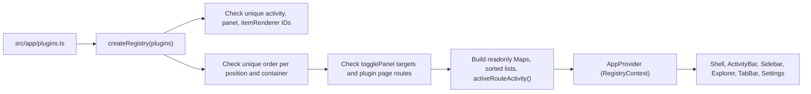

If any plugin breaks an invariant, the app fails immediately at startup (and fails `npm test`) rather than crashing later on a click.

### 6.2 Opening, Syncing & Closing a Tab

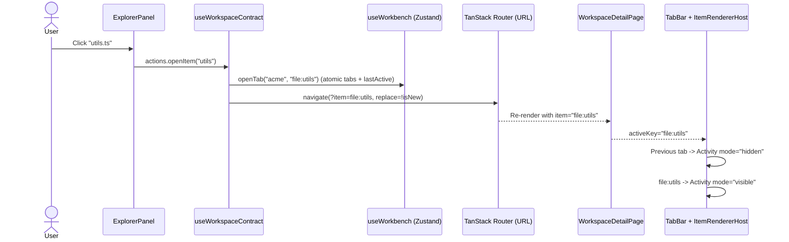

### 6.3 Cross-Plugin State Sharing (`workspace` <-> `primary` <-> `explorer` <-> `agent`)

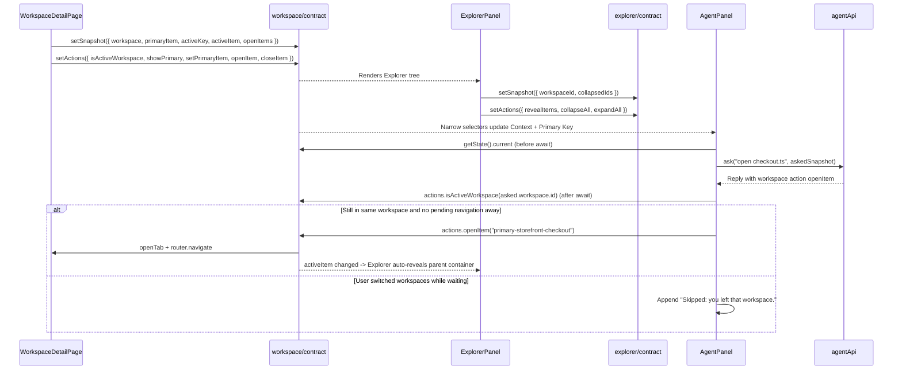

---

## 7. Critical User Journeys (CUJs) & Critical User Interactions (CUIs)

### CUJ 1: Create a New Workspace & Select Its Primary Key

**User goal:** Create a workspace via the modal dialog, land directly on its pinned Primary tab, and choose its Primary Key to seed the primary root node and linked child items.

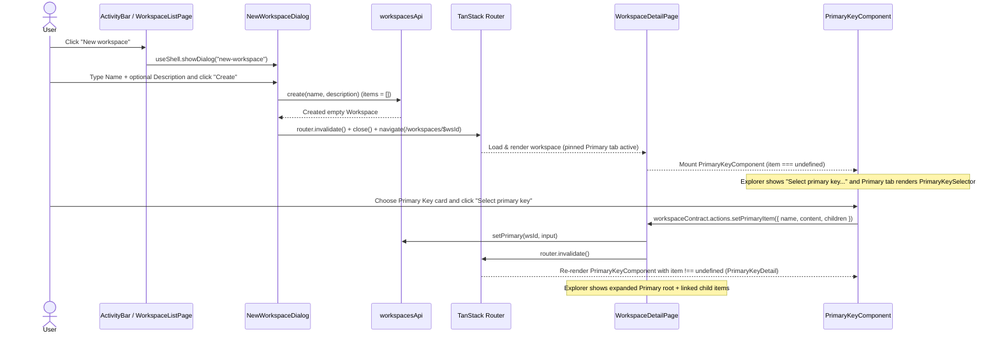

**Critical User Interactions (CUIs) in CUJ 1:**

| Interaction | Trigger | Visual & State Result | Edge Case Handled |
| --- | --- | --- | --- |
| Open creation dialog | Click `New workspace` (Activity Bar `[+]` or Workspaces page) | `DialogHost` opens `NewWorkspaceDialog` over the current screen without changing the URL | Pressing `Esc` or `Cancel` closes the dialog cleanly without touching browser history or `lastHref` |
| Submit invalid Name | Submit empty Name (or whitespace-only Name) | Native HTML `required` catches empty input; `formAction` catches whitespace-only input with `role="alert"` and `aria-invalid="true"` | Dialog stays open with typed fields preserved |
| Create workspace | Click `Create` | Button shows `"Creating…"` (`useFormStatus`), dialog closes, router navigates to `/workspaces/$wsId` | Pinned first tab renders `PrimaryKeyComponent` (`item === undefined`), and Explorer shows `Select primary key…` |
| Select Primary Key | Choose a Primary Key option in `PrimaryKeySelector` and click `Select primary key` | Button shows `"Applying…"` (`useTransition`), calls `actions.setPrimaryItem(...)`, seeds `type: 'primary'` root + linked children, and transitions `PrimaryKeyComponent` in-place to `PrimaryKeyDetail` | Workspace and Explorer stay agnostic of how `PrimaryKeyComponent` renders its selector or detail view |

---

### CUJ 2: Explore Items, Edit Files, Switch & Close Tabs

**User goal:** Browse the primary root and Explorer item-type groups, edit files across multiple tabs without losing work, and return cleanly to the pinned Primary tab.

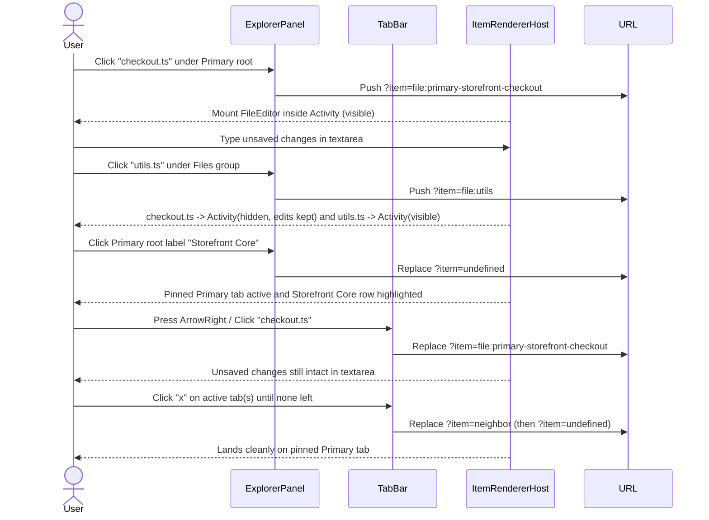

**Critical User Interactions (CUIs) in CUJ 2:**

| Interaction | Trigger | Result |
| --- | --- | --- |
| Click Primary root **label** | Click `Storefront Core` text in Explorer | Activates pinned **Primary** tab (`item: undefined`), clears `lastActive[wsId]`, highlights primary root, and expands children if collapsed |
| Click Primary root **chevron** | Click `v` / `>` button left of label | Collapses/expands children without changing the active editor tab |
| Click Type group header | Click `Notebooks`, `Files`, or `Datasets` row | Toggles `group:<type>` in `useExplorerStore.collapsed` (persisted in `localStorage`) |
| Click a breadcrumb parent | Click `Storefront Core` in top breadcrumbs | Calls `useExplorerContract` `revealItems` to un-collapse it in Explorer |
| Keyboard tab switching | Focus active tab, press `ArrowLeft` / `ArrowRight` / `Home` / `End` | Moves focus and activates tabs across `[Primary, ...openTabs]` with roving `tabIndex` |
| Deep-link invalid `?item=` | Visit `/workspaces/acme?item=folder:src` or `?item=bad` | Malformed syntax (`bad`) is stripped by `validateDetailSearch`; well-formed unknown/non-rendered keys (`folder:src`) are **not** persisted to `localStorage`, and `ItemRendererHost` displays an inline `"not in this workspace"` / `"No renderer registered"` message |

---

### CUJ 3: Switch Workspaces & Switch Top-Level Areas

**User goal:** Move between `Acme` and `Globex`—or jump to `Reports` / `Settings` and come back—while preserving your workspace layout, open tab strip, and open sidebar panels.

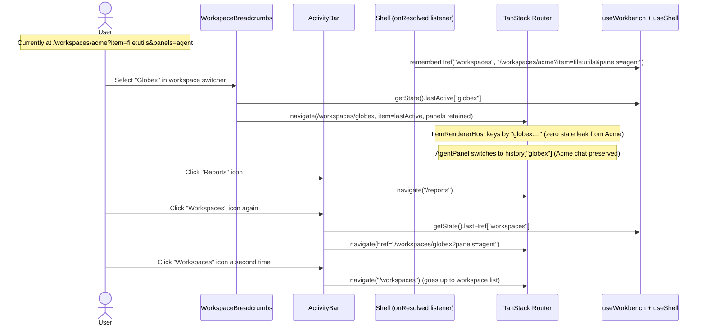

**Critical User Interactions (CUIs) in CUJ 3:**

| Interaction | Trigger | Result |
| --- | --- | --- |
| Switch workspace | Change `<select>` in breadcrumbs | Keeps `?panels=` open (`retainSearchParams`), lands on target workspace's `lastActive` tab (or pinned Primary tab); `AgentPanel` keeps separate `history[wsId]` |
| Return to area | Click unselected `Workspaces` or `Reports` icon | Restores exact `lastHref` (including search params or `/reports/q1`) |
| Go up inside area | Click already-selected `Workspaces` icon while inside `/workspaces/acme` | Navigates up to `/workspaces` list |
| Workspace isolation | Switch `Acme` <-> `Globex` | `ItemRendererHost` keys `Activity` by `${workspace.id}:${key}`, preventing cross-workspace file leaks (note: unsaved edits in `Acme` unmount on workspace switch) |

---

### CUJ 4: Resize Sidebar & Chat with the Agent

**User goal:** Open the Agent panel, resize the Explorer/Agent split smoothly, and ask the Agent to open/close files or collapse/expand Explorer sections.

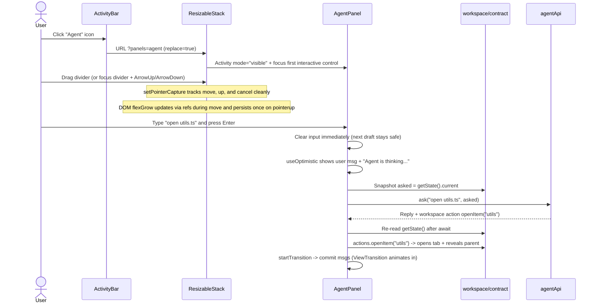

**Critical User Interactions (CUIs) in CUJ 4:**

| Interaction | Trigger | Result |
| --- | --- | --- |
| Toggle Agent off & on | Click `Agent` icon or panel `x` button | `?panels=` toggled with `replace: true`; chat messages stay alive in `Activity`; showing a hidden panel moves focus to its first interactive control |
| Resize panels (mouse/touch) | Drag `.divider` | `setPointerCapture` tracks pointer cleanly; DOM `flexGrow` updates with zero React renders and `localStorage` is written once on `pointerup` |
| Resize panels (keyboard) | Tab to `.divider`, press `ArrowUp` / `ArrowDown` | Shifts split ratio by 10% steps and updates `aria-valuenow` |
| Type while Agent thinks | Submit prompt, immediately start typing follow-up | Input clears on submit and is **not** wiped when the reply arrives |
| Leave workspace mid-reply | Submit `"open utils.ts"` in Acme, switch to Globex within 600ms | Reply still records in Acme's chat history, and action is safely skipped (`"Skipped: you left that workspace."`) |
| Agent API error | `agentApi.ask` rejects | Caught by `try/catch` and rendered as an error message instead of crashing |

---

### CUJ 5: Reset Workbench Layout, Plugin Pages & Modal Dialogs

| Interaction | Where | Behavior |
| --- | --- | --- |
| Reset layout | `/settings` -> `Close all tabs and reset panel sizes` | Calls `resetAllPersisted()` (resets `useWorkbench`, `useExplorerStore`, and `useShell.lastHref` in-memory + clears `ide:*` in `localStorage` without `location.reload()`, keeping in-memory created workspaces). |
| Browse plugin sub-views | `/reports` -> click `Q1 revenue` -> `/reports/q1` | Handled by catch-all `/$activityId/$` -> `PluginPageHost` -> lazy `ReportsPage` (`subPath="q1"`), updating document `<title>` |
| Open/dismiss modal dialog | Activity Bar `[+]` (`NewWorkspaceDialog`), `[?]` (`ShortcutsDialog`), or any `kind: 'dialog'` plugin | `DialogHost` opens native `<dialog closedby="any">` via `showModal()`; `Esc`, `Done`/`Cancel`, and backdrop click all route through `onClose` -> `hideDialog`; Safari fallback checks pointerdown + bounding box so text-selection drags don't dismiss the modal |

---

## 8. How to Extend This Shell

To add a brand-new plugin, export it with `definePlugin(...)` from `src/features/<name>/plugin.ts` (via `src/features/<name>/index.ts`) and register it in `src/app/plugins.ts`.

| Goal | What to change |
| --- | --- |
| Share state/actions with other plugins | Export `createPluginBridge<Snapshot, Actions>()` from `src/features/<name>/contract.ts` (follow `src/features/explorer/contract.ts`). Other features import `@/features/<name>/contract`. |
| Add a new Explorer item renderer | Add `{ type, label, pluralLabel?, icon, component: lazy(...) }` to `itemRenderers` in a plugin (`src/features/notebook/plugin.ts`). `ExplorerPanel`, `TabBar`, and `ItemRendererHost` pick it up automatically. |
| Customize or swap the pinned Primary renderer | Update or replace `src/features/primary/plugin.ts` (`type: 'primary'`). Its `component` receives `{ workspace, item }` (`item === undefined` before selection) and calls `useWorkspaceContract.getState().actions?.setPrimaryItem(...)` when selected. |
| Add a new sidebar panel + toggle button | Add a `panels` entry (`container: 'workspace.detail'`) and an `activities` entry with `action: { kind: 'togglePanel', panelId }`. |
| Add a standalone plugin page | Add an `activities` entry with `action: { kind: 'route', to: '/<id>', page: lazy(...) }`. No file in `src/routes/` needed. |
| Add a new dialog button | Add an `activities` entry with `action: { kind: 'dialog', dialog: lazy(...) }` (see `NewWorkspaceDialog` in `src/features/workspace/` and `ShortcutsDialog` in `src/features/settings/`). |
| Connect a real backend | Replace the mock bodies in `src/features/workspace/api/workspaces.ts` and `src/features/agent/api/agent.ts` with `fetch` calls. Keep `router.invalidate()` after mutations. |

### 8.1 Uniform `ItemRenderer` Mapping (`primary`, `notebook`, and Core Types)

`createRegistry(plugins)` merges `itemRenderers` across every loaded plugin (`plugins.flatMap((p) => p.itemRenderers ?? [])`). Every item `type` uses the **exact same `ItemRenderer` contract**—with no `isPrimary`, `isContainer`, or split `editor`/`details` flags:

```ts
export interface ItemRendererProps {
  readonly workspace: WorkspaceInfo;
  readonly item?: Item;
}

export interface ItemRenderer {
  readonly type: string;
  readonly label: string;
  readonly pluralLabel?: string;
  readonly icon: Icon;
  readonly component?: Lazy<ItemRendererProps>;
}
```

- **Pinned Primary renderer (`src/features/primary/plugin.ts`):** Registers `type: 'primary'` -> `PrimaryKeyComponent`. `ItemRendererHost` mounts it in the pinned first tab (`?item=` omitted). When `item === undefined` (new workspace), `PrimaryKeyComponent` renders `PrimaryKeySelector` and signals selection via `useWorkspaceContract.getState().actions?.setPrimaryItem(...)`; when `item !== undefined`, it renders `PrimaryKeyDetail`. Neither `workspace` nor `explorer` knows how `PrimaryKeyComponent` renders its internal states.
- **Standalone feature renderer (`src/features/notebook/plugin.ts`):** Registers `type: 'notebook'` -> `NotebookEditor` (`pluralLabel: 'Notebooks'`). `ExplorerPanel` groups top-level notebooks under **Notebooks**, `TabBar` renders the tab icon, and `ItemRendererHost` lazy-loads `NotebookEditor` inside `<Activity>` so cell outputs survive tab switches.
- **Core lightweight viewers & grouping nodes (`src/features/workspace/plugin.ts`):** Registers `file` (`FileEditor`), `dataset` (`DatasetEditor`), and `folder` (`component` omitted—top-level folders render as expandable containers with their nested `parentId` subtree rather than duplicating children into root type groups, and clicking an item without a `component` toggles expand/collapse). Unregistered backend item types fall back cleanly into Explorer's **Other** group.

---

## 9. Verification & CI Pipeline

Every change is checked locally and on push to `main` via `.github/workflows/deploy-pages.yml`:

1. `npm run typecheck` (`tsc --noEmit`) — strict TypeScript 6 + `noUncheckedIndexedAccess`.
2. `npm run lint` (`eslint .`) — TypeScript rules, React Hooks / React Compiler rules, and folder + plugin-contract boundaries.
3. `npm test` (`node --import ./tests/setup-aliases.mts --test 'tests/**/*.test.ts'`) — Node 24 unit tests for `createRegistry`, `createPluginBridge`, `tabs`, `explorer`, `workbench`, `agentApi`, `search-params`, and `workspacesApi`.
4. `npm run build` / `npm run build:demo` — production Vite build (failing on any React Compiler `CompileError`) and single-file `#/` hash-routed demo build deployed to GitHub Pages.
