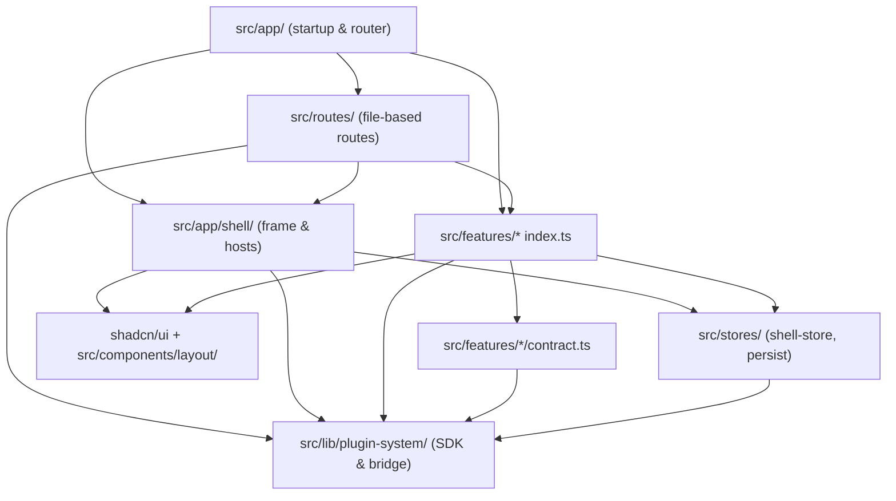

# Design Doc 1: IDE Shell, Resizable Layout & Plugin Foundation

> [!NOTE]
> **Standalone OpenSpec Blueprint for a New Project (Not for Modifying This Repo).**
> Stored in `ide-shell` for reference, this document is intended to generate **Phase 1 OpenSpec artifacts** when bootstrapping a **brand-new project** using **shadcn/ui**. (For how this `ide-shell` prototype itself works today, see [../DESIGN.md](../DESIGN.md).)
>
> **Scope:** Defines the outer application shell, resizable container primitives, shell URLs (`pathname` + `?panels=`), boot-time plugin registry, and cross-plugin state bridge—independent of Explorer or domain item types (covered in Phase 2: [02-explorer-and-item-renderers-design.md](./02-explorer-and-item-renderers-design.md)).

---

## 1. Context, Goals & Non-Goals

### 1.1 Context
We are building a modular, VS Code–style web application shell in **React 19.3**, **TanStack Router**, **Zustand 5**, **Vite 8**, **TypeScript 6**, and **shadcn/ui** (from our shared UI repository). Multiple teams/features will contribute navigation activities, modal dialogs, standalone pages, and contextual sidebar panels without coupling to each other's internals or triggering cross-shell re-render cascades.

### 1.2 Goals (Phase 1 Scope)
1. **Outer Application Frame (`app/shell`):** Activity Bar (left), dynamic Breadcrumb Bar (top), Main Route Outlet (center), Standalone Plugin Page Host (`/$activityId/$`), and shared Modal Dialog Host.
2. **shadcn/ui Layout & Resizable Split Primitives:**
   - **Horizontal split** (`ResizablePanelGroup` / `ResizablePanel` / `ResizableHandle`) between the **Sidebar Panel Container** and the **Main Content Area** inside any container route (e.g. `workspace.detail`), with persisted width ratios and collapsible/min-max bounds.
   - **Vertical split** inside the Sidebar Panel Container stacking an always-on primary panel (such as Explorer in Phase 2) above optional toggleable panels (`?panels=agent,...`), with persisted height ratios.
   - Standardize shell UI on existing **shadcn/ui** components (`Breadcrumb`, `Dialog`, `Tooltip`, `Button`, `Select`, `ScrollArea`, `Separator`).
3. **Boot-Time Plugin SDK (`lib/plugin-system`):**
   - Declarative plugin registration (`definePlugin`, `createRegistry`) for `activities` (`route` | `togglePanel` | `dialog`) and `panels`, failing fast at startup on duplicate IDs, duplicate sort `order`s, or broken references.
   - Route-agnostic shell location hook (`useShellLocation()`) derived from URL + route `staticData.container`.
   - Typed cross-feature state & action bridge (`createPluginBridge` + `.usePublish`) so features share public contracts without importing sibling internals.
4. **Lazy Code-Splitting + State Preservation (`LazyActivity`):**
   - Defer mounting lazy plugin panels/views until first shown (preserving Vite chunk splitting), then keep them mounted inside React 19 `<Activity>` when hidden so local state survives panel toggles.
5. **Machine-Enforced Architecture:**
   - ESLint `no-restricted-imports` enforcing strict one-way folder boundaries, plus a Vite React Compiler 1.0 `CompileError` build guard.

### 1.3 Non-Goals (Deferred to Phase 2 or Out of Scope)
- **Explorer tree, workspace items, tabs, and `ItemRenderer` dispatch** — deferred to **Phase 2** ([02-explorer-and-item-renderers-design.md](./02-explorer-and-item-renderers-design.md)). Phase 1 validates container hosting with a lightweight placeholder container route, `Settings` page, `Reports` plugin page, and `ShortcutsDialog`.
- **No code-editor assumptions:** The shell is a domain-agnostic workbench frame, not a text/code editor.
- **No runtime plugin marketplace/unloading:** Plugins are registered statically in `src/app/plugins.ts` at startup.

---

## 2. Visual Layout & shadcn/ui Component Mapping

### 2.1 Shell & Container Split Anatomy

```text
+------+-------------------------------------------------------------------------+
| Act  | Breadcrumb Bar (shadcn Breadcrumb + route-contributed Breadcrumbs slot) |
| Bar  +------------------------+--+---------------------------------------------+
|      | SIDEBAR CONTAINER      |  | MAIN CONTENT AREA                           |
| [WS] | (Always-on panel slot) |  | (Route page or Phase 2 Item Tabs + Content) |
| [Ag] |                        |  |                                             |
| [Rp] +=== ResizableHandle ====+  |                                             |
|      | OPTIONAL PANEL (?panels|  |                                             |
|      | e.g. Agent)        [x] |  |                                             |
| [+]  |                        |  |                                             |
| [?]  |                        |  |                                             |
| [*]  |                        |  |                                             |
+------+------------------------+--+---------------------------------------------+
                                 ^^
                    shadcn ResizableHandle (horizontal:
                  Sidebar Container <-> Main Content Area)
```

### 2.2 shadcn/ui Primitive Mapping

Reuse components directly from the shared **shadcn/ui** package rather than building custom low-level primitives:

| Shell Surface | shadcn/ui Components Used | Accessibility & Behavior Notes |
| --- | --- | --- |
| **Horizontal Workbench Split** (Sidebar <-> Main Content) | `ResizablePanelGroup` (`direction="horizontal"`), `ResizablePanel`, `ResizableHandle` | Keyboard (`ArrowLeft`/`ArrowRight`, `Home`/`End`) & pointer drag built in via `react-resizable-panels`. Persist layout via `onLayout` (debounced/committed) to Zustand `ide:layout`. Set sensible `defaultSize={22}`, `minSize={15}`, `maxSize={45}` on the sidebar panel. |
| **Vertical Sidebar Stack** (Stacked panels inside Sidebar) | `ResizablePanelGroup` (`direction="vertical"`), `ResizablePanel`, `ResizableHandle` | Shown when 2+ panels are visible in the active container. Closing an optional panel `[x]` removes its ID from `?panels=` with `replace: true`. |
| **Activity Bar** (`48px` left rail) | `TooltipProvider`, `Tooltip`, `TooltipTrigger`, `TooltipContent`, `Button` (`variant="ghost"`, `size="icon"`) | Three visual states: `selected` (`aria-current="page"` accent bar for active `route`), `on` (`aria-pressed="true"` filled state for active `togglePanel`), `off` (default; `dialog` triggers add `aria-haspopup="dialog"`). Disabled buttons show `disabledReason` in tooltip. |
| **Top Breadcrumb Bar** (`30px` top rail) | `Breadcrumb`, `BreadcrumbList`, `BreadcrumbItem`, `BreadcrumbLink`, `BreadcrumbPage`, `BreadcrumbSeparator` | Shell renders static `crumb` labels from matched routes and mounts any route's custom `staticData.Breadcrumbs` component inside `<Suspense>`. |
| **Modal Dialog Host** (`DialogHost`) | `Dialog`, `DialogContent`, `DialogHeader`, `DialogTitle`, `DialogDescription` | Controlled by `useShell((s) => s.openDialog)`. Handles focus trap, `Esc`, backdrop click, and focus restoration to the triggering button automatically. |
| **Panel & Page Scroll Regions** | `ScrollArea` | Used inside sidebar panel bodies and settings tables so outer shell chrome never scrolls. |

---

## 3. Folder Architecture & Dependency Boundaries



### ESLint Boundary Matrix (`eslint.config.js`)

| Layer | Allowed Imports | Forbidden by `no-restricted-imports` |
| --- | --- | --- |
| `src/lib/plugin-system/**` | External packages (`react`, `zustand`, `@tanstack/react-router`) | `app`, `routes`, `features`, `stores`, `components` |
| `src/components/**` (UI & layout wrappers) | External packages & shared `shadcn/ui` | `app`, `routes`, `features`, `stores`, `lib` |
| `src/stores/**` | `lib/plugin-system`, `zustand` | `app`, `routes`, `features`, `components` |
| `src/app/shell/**` | `lib/plugin-system`, `stores`, `components`, `shadcn/ui` | `features`, `routes` (shell never imports a feature) |
| `src/app/**` & `src/routes/**` | `@/features/<name>` barrel (`index.ts`), `app/shell`, `lib`, `stores`, `components` | Deep `@/features/<name>/**` internals |
| `src/features/<name>/**` | `lib`, `stores`, `components`, `shadcn/ui`, `@/features/<other>/contract`, own relative files | `app`, `routes`, sibling feature barrels & internals (both `@/` and `../`) |
| `src/features/*/contract.ts` | `@/lib/plugin-system` only | Everything else (contracts stay pure) |

---

## 4. Plugin SDK & Public Contracts (`src/lib/plugin-system/`)

### 4.1 Core SDK Types (`types.ts`)

```ts
import type { ComponentType, LazyExoticComponent } from 'react';

export const EMPTY: readonly never[] = Object.freeze([]);

export type Icon = ComponentType<{ size?: number | string; className?: string }>;
export type Lazy<P = Record<string, never>> = LazyExoticComponent<ComponentType<P>> | ComponentType<P>;

/** Route-agnostic shell location derived from pathname, ?panels=, and route staticData. */
export interface ShellLocation {
  readonly path: string;
  readonly container?: string;
  readonly panels: readonly string[];
}

export interface RouteAction {
  readonly kind: 'route';
  /** Area home path, e.g. '/workspaces'. Standalone plugin pages must use `/${activity.id}`. */
  readonly to: string;
  /** Optional lazy page rendered by PluginPageHost under `/$activityId/$`. */
  readonly page?: Lazy<{ subPath: string }>;
  /** Restore last URL inside this area when returning from another area. */
  readonly rememberLastLocation?: boolean;
}

export interface TogglePanelAction {
  readonly kind: 'togglePanel';
  readonly panelId: string;
}

export interface DialogProps {
  close: () => void;
}

export interface DialogAction {
  readonly kind: 'dialog';
  readonly dialog: Lazy<DialogProps>;
}

export interface Activity {
  readonly id: string;
  readonly title: string;
  readonly icon: Icon;
  readonly order: number;
  readonly position?: 'top' | 'bottom';
  readonly enabledWhen?: (location: ShellLocation) => boolean;
  readonly disabledReason?: string;
  readonly action: RouteAction | TogglePanelAction | DialogAction;
}

export interface SidebarPanel {
  readonly id: string;
  readonly title: string;
  /** Matches route `staticData.container` (e.g. 'workspace.detail'). */
  readonly container: string;
  readonly order: number;
  /** Always visible in its container (e.g. Explorer); optional panels toggle via `?panels=`. */
  readonly alwaysOn?: boolean;
  readonly component: Lazy;
}

export interface Plugin {
  readonly id: string;
  readonly activities?: readonly Activity[];
  readonly panels?: readonly SidebarPanel[];
  // Extended in Phase 2 with `readonly itemRenderers?: readonly ItemRenderer[]`
}

export const definePlugin = (plugin: Plugin): Plugin => plugin;
```

### 4.2 Boot-Time Registry Invariants (`registry.ts`)
`createRegistry(plugins)` runs once at startup and throws immediately if:
1. Two plugins register the same `activity.id` or `panel.id`.
2. Two activities share the same `(position, order)` or two panels share the same `(container, order)`.
3. A `togglePanel` activity references an unknown `panelId`.
4. A standalone plugin page activity (`action.kind === 'route'` with `action.page`) sets `action.to !== "/${activity.id}"`.

### 4.3 Cross-Plugin State Bridge (`bridge.ts`)
Features share live state/actions through pure `src/features/<name>/contract.ts` files backed by `createPluginBridge`:

```ts
export interface PluginBridgeState<Snapshot, Actions> {
  readonly current: Snapshot | null;
  readonly actions: Actions | null;
  setSnapshot(current: Snapshot): void;
  setActions(actions: Actions): void;
  clear(): void;
}

export interface PluginBridge<Snapshot, Actions>
  extends UseBoundStore<StoreApi<PluginBridgeState<Snapshot, Actions>>> {
  /** Publishes snapshot (`null` for actions-only bridges) & actions in useLayoutEffect; clears on unmount. */
  usePublish(snapshot: Snapshot | null, actions: Actions): void;
}
```

- **React Compiler compatibility rule:** Export `export const usePublishMyContract = useMyContract.usePublish;` from `contract.ts` so components call `usePublishMyContract(...)` directly as a hook rather than referencing `useMyContract` as a property object during render.
- **No-op guard:** `setSnapshot` checks `Object.is(get().current, current)` before calling `set()`, and `clear()` skips `set()` when already `null`.

---

## 5. Routing, Layout Container & State Rules

### 5.1 Route Tree & `staticData` Augmentation

```ts
declare module '@tanstack/react-router' {
  interface StaticDataRouteOption {
    crumb?: (params: Readonly<Record<string, string>>, registry: Registry) => string;
    Breadcrumbs?: ComponentType;
    container?: string;
  }
}
```

- `/` -> redirects to `/workspaces`.
- `/workspaces` (`crumb: () => 'Workspaces'`) -> child routes `/workspaces/` and `/workspaces/$wsId` (`staticData: { container: 'workspace.detail' }`, `retainSearchParams(['panels'])`).
- `/settings` (`crumb: () => 'Settings'`) -> displays workbench layout reset button and loaded plugin inspection table.
- `/$activityId/$` -> `PluginPageHost` renders any plugin's `RouteAction.page` with `subPath = _splat ?? ''`.

### 5.2 Reusable Container Split Layout (`ContainerWorkbenchLayout`)
To avoid coupling the shell to Explorer internals while giving Phase 2 a turnkey layout:
- `ContainerWorkbenchLayout` accepts `{ container: string; children: ReactNode }`.
- Renders a horizontal shadcn `ResizablePanelGroup` (`autoSaveId={`ide:split:${container}`}` or synced to `persistStorage`):
  - **Left `ResizablePanel` (`SidebarPanels`):** Queries `registry.panelsFor(container)`. Renders visible panels (`alwaysOn || panels.includes(p.id)`) inside a vertical `ResizablePanelGroup`, wrapping each panel in `<LazyActivity active={visible}>` so hidden panels never download lazy chunks on initial page load, and stay mounted once opened.
  - **`ResizableHandle`** (with keyboard & pointer support).
  - **Right `ResizablePanel` (`children`):** Hosts the container's main view (in Phase 2: `ItemTabs` + `ItemRendererHost`).

### 5.3 Render-Isolation & Performance Rules
1. **`useShellLocation()`** uses `useRouterState({ structuralSharing: true })` projecting only `{ path, container, panels }`—query param changes unrelated to panels (like Phase 2's `?item=`) cause **zero** re-renders in `ActivityBar`.
2. **`Breadcrumbs`** projects only matched route `{ id, routeId, pathname, status, params }` with `structuralSharing: true`—search param updates never re-render the outer shell breadcrumb bar.
3. **`Shell` `lastHref` tracking** subscribes via `router.subscribe('onResolved', ...)` inside `useEffect` and `ActivityBar` reads `useShell.getState().lastHref[id]` inside `onClick`—zero root `<Shell>` re-renders on navigation.
4. **React Compiler 1.0 enforcement:** `vite.config.ts` throws on any `CompileError` inside `/src/` so silent memoization bailouts fail CI immediately.
5. **In-memory layout reset (`resetAllPersisted()`):** Clears all `ide:*` keys in `localStorage` and resets registered Zustand stores (`panelSizes`, `lastHref`) in memory without `location.reload()`.

---

## 6. Phase 1 Verification & Acceptance Scenarios (for OpenSpec)

1. **Boot-Time Registry Validation:**
   - *Scenario:* Registering duplicate activity/panel IDs, duplicate `(position, order)` values, an unknown `togglePanel` target, or a plugin page with `to !== "/${id}"` throws a descriptive error during `createRegistry`.
2. **Activity Bar Navigation & Area Memory:**
   - *Scenario:* Navigating to `/reports/q1`, switching to `/settings`, and clicking `Reports` restores `/reports/q1` (`rememberLastLocation: true`). Clicking `Reports` again while on `/reports/q1` navigates up to `/reports`.
3. **Contextual Panel Toggling & Lazy Code-Splitting:**
   - *Scenario:* On a route without `container: 'workspace.detail'` (e.g. `/settings`), panel toggle buttons with `enabledWhen: (loc) => loc.container === 'workspace.detail'` are disabled with tooltip reason.
   - *Scenario:* Opening a container route with no `?panels=` does **not** download optional panel chunks. Toggling a panel on updates `?panels=` with `replace: true`, downloads and mounts the panel, and subsequent hide/show cycles preserve local state inside `LazyActivity`.
4. **Horizontal & Vertical Resizing (shadcn `Resizable`):**
   - *Scenario:* Dragging or pressing arrow keys on the horizontal `ResizableHandle` resizes the Sidebar Container vs. Main Content Area and restores the ratio on reload; clicking Reset in `/settings` restores default sizes in memory.
5. **Modal Dialog Lifecycle (shadcn `Dialog`):**
   - *Scenario:* Clicking a `kind: 'dialog'` activity opens its lazy dialog in `DialogHost` without pushing a URL history entry; pressing `Esc`, clicking outside, or calling `close()` unmounts the dialog and restores focus to the trigger button.
6. **Boundary Enforcement:**
   - *Scenario:* Importing `@/features/*` from `src/app/shell/**` or importing sibling internals across `src/features/*` fails `npm run lint`.
