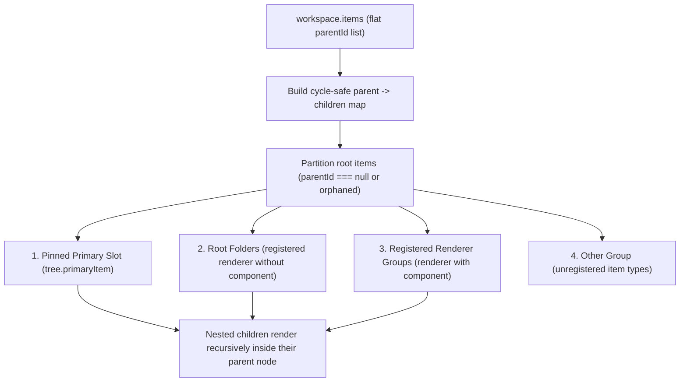
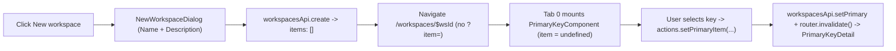

# Design Doc 2: Workspace, Explorer & Type-Based Item Renderers

> [!NOTE]
> **Standalone OpenSpec Blueprint for a New Project (Not for Modifying This Repo).**
> Stored in `ide-shell` for reference, this document is intended to generate **Phase 2 OpenSpec artifacts** when building a **brand-new project** on top of Phase 1 ([01-shell-and-layout-design.md](./01-shell-and-layout-design.md)) using **shadcn/ui**, with **zero modifications to `app/shell`**. (For how this `ide-shell` prototype itself works today, see [../DESIGN.md](../DESIGN.md).)
>
> **Scope:** Defines the Workspace container (`/workspaces/$wsId` + `?item=type:id`), Explorer tree, item tabs, and uniform **type-based `ItemRenderer` architecture**.

---

## 1. Context, Core Philosophy & Scope

### 1.1 Not an "Editor" — Uniform Type-Based Item Rendering
Unlike a code editor where every tree node is a text file, items in our workspace represent diverse domain objects (`primary` key configurations, `dataset` tables, `notebook`s, reports, schemas, `folder` groupings, or documents).

**Core design rule:**
- Every workspace item has `{ id, type, name, parentId, content? }`.
- Plugins map an item `type` to a single lazy **`ItemRenderer`** (`{ type, label, pluralLabel?, icon, component? }`).
- Neither `workspace` nor `explorer` knows or cares *what* a renderer's `component` displays—a selector wizard, a read-only summary card, a data grid, an interactive notebook, or a form.
- There are **no** over-engineered item-type flags (`isPrimary`, `isContainer`, or separate `editor` vs. `details` slots):
  - `type === PRIMARY_TYPE` (`'primary'`) is pinned at tab index `0` (`?item=` omitted).
  - Any other `type` with a `component` opens in a closable item tab (`?item=type:id`) and gets a collapsible type section in Explorer.
  - Any `type` without a `component` (e.g. `type: 'folder'`) acts purely as an expandable grouping folder in Explorer.
  - Any item with `parentId` children automatically renders an expand/collapse chevron in Explorer.

### 1.2 Goals (Phase 2 Scope)
1. **SDK Extension (`lib/plugin-system`):** Add `Item`, `WorkspaceInfo`, `ItemRenderer`, `ItemRendererProps`, `PRIMARY_TYPE`, `findPrimaryItem`, and `Plugin.itemRenderers`.
2. **Workspace Container (`core.workspace`):**
   - Workspace list page (`/workspaces/`) and `NewWorkspaceDialog` (`kind: 'dialog'` using shadcn `Dialog`), creating an empty workspace (`items: []`) and navigating directly to `/workspaces/$wsId`.
   - Workspace detail layout (`/workspaces/$wsId`, `container: 'workspace.detail'`) using Phase 1's horizontal **shadcn `ResizablePanelGroup`** between the **Sidebar Panel Container** and **Item Tabs + `ItemRendererHost`**.
   - Interactive `WorkspaceBreadcrumbs` (shadcn `Breadcrumb` + `Select` workspace switcher + clickable ancestor path).
   - Persisted per-workspace open item tabs (`ide:workspace`) + public `workspace/contract.ts`.
3. **Explorer (`core.explorer`):**
   - `alwaysOn: true` sidebar panel reading `workspace/contract`, rendering the pinned Primary slot, root folders, collapsible `ItemRenderer` type groups, and an `"Other"` fallback group for unregistered backend types.
   - Persisted collapsed node/group state (`ide:explorer`) + public `explorer/contract.ts` (`revealItem`, `collapseAll`, `expandAll`).
4. **Pluggable Primary Feature (`feature.primary`) & Example Renderers (`example.notebook`, etc.):**
   - `PrimaryKeyComponent` owns both unselected (`item === undefined` -> selector) and configured (`item !== undefined` -> detail view) states internally, signaling selection via `workspaceContract.actions.setPrimaryItem(...)`.

### 1.3 Non-Goals
- Rich code-editing features (syntax highlighting, Monaco, split editor panes, file-save diffing).
- Drag-and-drop tree reordering or inline item rename/delete mutations (can be added later via `workspace/contract` actions).

---

## 2. Layout & shadcn/ui Component Mapping

### 2.1 Workspace Detail Split Layout

```text
+------+---------------------------------------------------------------------------+
| Act  | Workspaces  /  [Acme v] (Select)  /  Storefront Core  /  catalog.csv      |
| Bar  +--------------------------+--+---------------------------------------------+
|      | EXPLORER                 |  | [Key: Storefront Core] [catalog.csv x]      |
| [WS] | v [Key] Storefront Core  |  +---------------------------------------------+
| [Ag] |     catalog.csv          |  |                                             |
| [Rp] |     checkout.ts          |  |  ItemRendererHost                           |
|      | > [Folder] archive       |  |  - Dispatches strictly by `item.type`       |
|      | v Notebooks          [1] |  |  - Tab 0: `registry.itemRenderer.get(       |
|      |     revenue.nb           |  |      'primary').component`                  |
|      | v Datasets           [1] |  |  - Tab N: `registry.itemRenderer.get(       |
|      |     sales.csv            |  |      item.type).component`                  |
|      +==== ResizableHandle =====+  |  - Wrapped in LazyActivity(${wsId}:${key})  |
|      | AGENT (optional)     [x] |  |                                             |
| [+]  | Context: Acme > catalog  |  |                                             |
| [?]  | Primary: Storefront Core |  |                                             |
+------+--------------------------+--+---------------------------------------------+
                                  ^^
                     shadcn ResizableHandle (horizontal:
                   Sidebar Panel Container <-> Tabs + Content)
```

### 2.2 shadcn/ui Component Mapping for Phase 2

| Feature Surface | shadcn/ui Components Used | Notes |
| --- | --- | --- |
| **Sidebar <-> Item Content Split** | `ResizablePanelGroup` (`direction="horizontal"`), `ResizablePanel`, `ResizableHandle` | Resizes the space between the Sidebar Panel Container (Explorer + optional panels) and the Item Tabs + `ItemRendererHost` pane. |
| **Workspace Breadcrumbs & Switcher** | `BreadcrumbItem`, `BreadcrumbSeparator`, `BreadcrumbPage`, `Select`, `SelectTrigger`, `SelectContent`, `SelectItem`, `Button` (`variant="link"` / `"ghost"`) | Workspace `<Select>` switches workspaces while preserving `?panels=` and restoring `lastActive[wsId]`; clicking a parent container crumb calls `explorerContract.actions.revealItem(id)`. |
| **New Workspace Dialog** | `DialogContent`, `DialogHeader`, `DialogTitle`, `Input`, `Textarea` / `Input`, `Label`, `Button` | Validates required `Name` (`useActionState` + `useFormStatus`), creates `{ id, name, description, items: [] }`, closes dialog, and navigates to `/workspaces/$wsId`. |
| **Explorer Tree & Type Sections** | `ScrollArea`, `Collapsible`, `CollapsibleTrigger`, `CollapsibleContent`, `Badge` (`variant="secondary"`), `Button` (`variant="ghost"`) | Collapsible type headers show registered `icon`, `pluralLabel`, and item count `Badge`. Rows with children + a `component` render a separate chevron toggle button next to the item button (never nesting `<button>` inside `<button>`). |
| **Item Tab Bar** (`ItemTabBar`) | `ScrollArea` (horizontal), `Button` (`variant="ghost"`) with WAI-ARIA `role="tablist"` / `role="tab"` | Supports closable tabs `[x]` alongside the non-closable pinned Primary tab at index `0`, with roving `tabIndex` (`ArrowLeft`, `ArrowRight`, `Home`, `End`). |
| **Primary Key Selector & Detail** | `Card`, `RadioGroup` / selectable `Card`s, `Badge`, `Button`, `Alert` | Inline `role="alert"` error display if `setPrimaryItem` rejects; zero route-level crash. |
| **Dataset / Tabular Item Renderer** | `Table`, `TableHeader`, `TableBody`, `TableRow`, `TableHead`, `TableCell` | Clean read-only data preview example demonstrating non-editor item rendering. |

---

## 3. SDK Extensions & Feature Contracts

### 3.1 Uniform `ItemRenderer` Types (`src/lib/plugin-system/types.ts`)

```ts
export const PRIMARY_TYPE = 'primary';

export interface Item {
  readonly id: string;
  readonly type: string;
  readonly name: string;
  readonly parentId: string | null;
  readonly content?: string;
}

export interface WorkspaceInfo {
  readonly id: string;
  readonly name: string;
  readonly description?: string;
  readonly items: readonly Item[];
}

export const findPrimaryItem = (workspace: WorkspaceInfo): Item | undefined =>
  workspace.items.find((i) => i.type === PRIMARY_TYPE && i.parentId === null);

export interface ItemRendererProps {
  readonly workspace: WorkspaceInfo;
  /** Defined for open items and configured primary items; `undefined` when `type: 'primary'` has not been selected yet. */
  readonly item?: Item;
}

export interface ItemRenderer {
  readonly type: string;
  readonly label: string;
  /** Explorer group heading; defaults to `${label}s`. */
  readonly pluralLabel?: string;
  readonly icon: Icon;
  /** Main-pane component. Omit for plain grouping containers such as `type: 'folder'`. */
  readonly component?: Lazy<ItemRendererProps>;
}
```

`createRegistry(plugins)` indexes `plugins.flatMap((p) => p.itemRenderers ?? [])` into `registry.itemRenderer: ReadonlyMap<string, ItemRenderer>` and throws at boot if two plugins register the same `type`.

### 3.2 Workspace Public Contract (`src/features/workspace/contract.ts`)

```ts
import { createPluginBridge, type Item, type WorkspaceInfo } from '@/lib/plugin-system';

export interface PrimaryChildSeed {
  readonly id: string;
  readonly type: string;
  readonly name: string;
  readonly content?: string;
}

export interface PrimarySelectionInput {
  readonly name: string;
  readonly content?: string;
  readonly children?: readonly PrimaryChildSeed[];
}

export interface WorkspaceSnapshot {
  readonly workspace: WorkspaceInfo;
  /** Root `type: 'primary'` item (`undefined` on a newly created workspace until selected). */
  readonly primaryItem?: Item;
  /** Raw `?item=` URL key (`"type:id"`), or `undefined` when the pinned Primary tab is active. */
  readonly activeKey?: string;
  /** Resolved Item when `activeKey` points to an openable non-primary item. */
  readonly activeItem?: Item;
  /** Items currently open in closable tabs, in tab order. */
  readonly openItems: readonly Item[];
}

export interface WorkspaceActions {
  /** True when `wsId` is active AND no navigation away from `/workspaces/${wsId}` is in flight. */
  isActiveWorkspace(wsId: string): boolean;
  /** Activate the pinned Primary tab (clears `?item=` with `replace: true`). */
  showPrimary(): boolean;
  /** Open `itemId` in a closable tab (or switch to Primary if `item.type === PRIMARY_TYPE`). */
  openItem(itemId: string): boolean;
  /** Close `itemId`'s tab and fall back to right neighbor -> left neighbor -> pinned Primary tab. */
  closeItem(itemId: string): boolean;
  /** Callback invoked by the `type: 'primary'` renderer when the user selects/saves the primary item. */
  setPrimaryItem(input: PrimarySelectionInput): Promise<boolean>;
}

export const useWorkspaceContract = createPluginBridge<WorkspaceSnapshot, WorkspaceActions>();
export const usePublishWorkspaceContract = useWorkspaceContract.usePublish;
```

**Why `primaryItem` lives on `workspace/contract` (not `primary/contract`):**
`workspace` owns the persisted `workspace.items` array; `feature.primary` owns only the UI renderer for `type: 'primary'`. Publishing `primaryItem` on `WorkspaceSnapshot` lets consumer plugins (such as `agent` or `reports`) read `s.current?.primaryItem` (`{ id, type, name, content }`) without importing `feature.primary`, even if `primaryPlugin` is swapped for another implementation.

### 3.3 Explorer Public Contract (`src/features/explorer/contract.ts`)

```ts
import { createPluginBridge } from '@/lib/plugin-system';

export interface ExplorerActions {
  /** Expand `itemId` (if collapsible) and every ancestor folder/group needed to make it visible. */
  revealItem(itemId: string): boolean;
  collapseAll(): void;
  expandAll(): void;
}

export const useExplorerContract = createPluginBridge<null, ExplorerActions>();
export const usePublishExplorerContract = useExplorerContract.usePublish;
```

Callers pass domain `itemId`s (`revealItem('primary-acme')` or `revealItem('src')`)—Explorer computes its own internal ancestor folder and `group:<type>` IDs privately.

---

## 4. Explorer Tree & Tab Lifecycle Design

### 4.1 Pure Explorer Tree Partitioning (`buildExplorerTree`)



1. **Cycle & Orphan Guard:** If backend data has an orphaned `parentId` or a cycle (`A -> B -> A`), `buildExplorerTree` treats the broken link as a root item so Explorer never infinite-loops or drops items.
2. **Pinned Primary Slot (top):**
   - When `tree.primaryItem === undefined`: renders a highlighted `"Select primary key…"` action row that calls `showPrimary()`.
   - When `tree.primaryItem !== undefined`: renders the primary root node (clicking label calls `showPrimary()` and expands if collapsed; clicking chevron toggles children without switching tabs).
3. **Root Folders:** Top-level items whose renderer omits `component` (`type: 'folder'`); clicking toggles expand/collapse, and children stay nested inside the folder rather than duplicated into root type groups.
4. **Type Sections:** One collapsible group (`group:<type>`) per non-primary `ItemRenderer` with a `component` (e.g. `Notebooks`, `Datasets`, `Files`), sorted alphabetically within each group.
5. **Unregistered `"Other"` Fallback (`group:__other__`):** Root items whose `type` has no loaded plugin appear under **Other** with a generic icon, and clicking one shows `"No renderer registered for type '<type>'"` in `ItemRendererHost` rather than silently disappearing.
6. **Auto-Reveal on Tab Change:** When `activeItem` changes in `workspace/contract`, Explorer expands its ancestor folders/group automatically in `useLayoutEffect`.

### 4.2 Workspace Creation, Tabs & `ItemRendererHost` Flow



- **URL <-> Persisted Tab Strip Sync:**
  - `?item=type:id` in the URL is the single source of truth for the *active* tab (`undefined` = pinned Primary tab).
  - `useWorkbench` (`ide:workspace`) persists `tabs[wsId]` and `lastActive[wsId]` with `get()` no-op guards before `set()` to avoid redundant `localStorage` writes.
  - Unopenable deep-linked keys (e.g. `?item=folder:src` or `?item=file:deleted`) are **never** written into `tabs[wsId]`, display an inline message in `ItemRendererHost`, and keep `ItemTabBar` keyboard-reachable by falling back `tabIndex={0}` onto the pinned Primary tab.
  - `useTabActions` aborts mutations if `router.state.location.pathname` has already moved away from `/workspaces/${ws.id}` (preventing cross-workspace tab corruption during in-flight navigations).
- **Isolated `LazyActivity` Mounting:**
  - `ItemRendererHost` keys every slot by `${workspace.id}:${key}` (`${workspace.id}:__primary__` for index `0`).
  - Restored background tabs from `localStorage` do **not** download their renderer chunks until activated; once viewed, `<Activity>` preserves their local state across tab switches while unmounting cleanly when switching workspaces.

---

## 5. Reference Plugins Included in Phase 2

| Plugin ID | Folder | Contributes | Demonstrates |
| --- | --- | --- | --- |
| `core.workspace` | `src/features/workspace/` | `workspaces` route activity, `new-workspace` dialog activity, `folder` / `file` / `dataset` `itemRenderers`, `workspace/contract.ts` | Container layout, `ItemTabBar`, `ItemRendererHost`, core lightweight viewers |
| `feature.primary` | `src/features/primary/` | `itemRenderers: [{ type: PRIMARY_TYPE, label: 'Primary Key', icon, component }]` | Self-contained stateful `type: 'primary'` plugin (selector -> detail via `setPrimaryItem`) |
| `core.explorer` | `src/features/explorer/` | `explorer` (`alwaysOn: true`) sidebar panel, `explorer/contract.ts` | Consuming `workspace/contract` + publishing `revealItem` / `collapseAll` / `expandAll` |
| `example.notebook` | `src/features/notebook/` | `itemRenderers: [{ type: 'notebook', label: 'Notebook', pluralLabel: 'Notebooks', icon, component }]` | Adding a brand-new item-type renderer in its own feature folder with zero edits to `workspace` or `explorer` |
| `core.agent` *(optional consumer)* | `src/features/agent/` | `agent` sidebar panel + toggle button | Reading `primaryItem` & `activeItem` via narrow selectors and dispatching `openItem(id) \|\| revealItem(id)` |

---

## 6. Phase 2 Verification & Acceptance Scenarios (for OpenSpec)

1. **Workspace Creation & Pluggable Primary Lifecycle:**
   - *Scenario:* Submitting `NewWorkspaceDialog` creates an empty workspace (`items: []`) and opens `/workspaces/$wsId` with `PrimaryKeyComponent` rendering its selector (`item === undefined`) and Explorer showing `"Select primary key…"`.
   - *Scenario:* Selecting a Primary Key calls `actions.setPrimaryItem(...)`, seeds the `type: 'primary'` root + linked children, transitions Tab `0` in-place to `PrimaryKeyDetail`, and expands the primary root in Explorer. If `setPrimaryItem` throws, an inline `role="alert"` error renders inside `PrimaryKeyComponent` without crashing the route.
2. **Type-Based Item Rendering & Lazy Chunks:**
   - *Scenario:* Registering a new `ItemRenderer` plugin (`type: 'notebook'`) automatically adds a collapsible **Notebooks** section in Explorer, renders its icon in `ItemTabBar`, and lazy-loads `NotebookRenderer` only when a notebook item is first activated.
   - *Scenario:* Items of an unregistered backend `type` appear under **Other** in Explorer rather than disappearing.
3. **Folder Hierarchy & Cycle Safety:**
   - *Scenario:* Top-level `folder` items (`component` omitted) render as expandable folders with their nested `parentId` children (without duplicating those children into root type groups). Cyclic `parentId` data neither freezes rendering nor drops items.
4. **Tab Navigation, Roving Focus & Workspace Isolation:**
   - *Scenario:* Opening a new item pushes history; switching between open tabs or closing a tab uses `replace: true`; closing the active tab activates its right neighbor, else left neighbor, else the pinned Primary tab.
   - *Scenario:* Visiting an invalid deep link (`?item=file:missing`) renders an inline message, does not persist `file:missing` to `localStorage`, and keeps `ItemTabBar` reachable via `Tab` (`tabIndex={0}` on the pinned Primary tab).
   - *Scenario:* Switching from `Acme` to `Globex` retains `?panels=`, restores `Globex`'s `lastActive` tab, and isolates per-workspace component state via `${wsId}:${key}` keys.
5. **Cross-Plugin State Sharing (`workspace` <-> `explorer` <-> consumer plugins):**
   - *Scenario:* Clicking an ancestor item in `WorkspaceBreadcrumbs` or dispatching an agent `openItem` on a folder expands its path via `explorerContract.actions.revealItem(id)` without exposing internal Explorer group IDs.
   - *Scenario:* Consumer plugins read `s.current?.primaryItem` (`{ id, type, name }`) from `workspace/contract` with zero imports from `feature.primary`, and skip async mutations if `isActiveWorkspace(wsId)` returns `false` after `await`.
